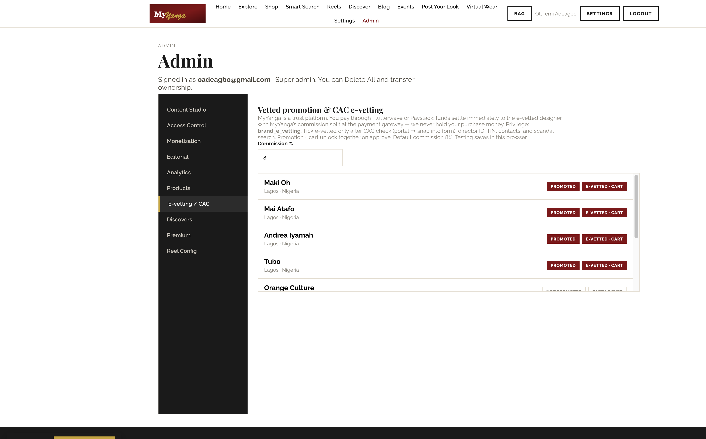
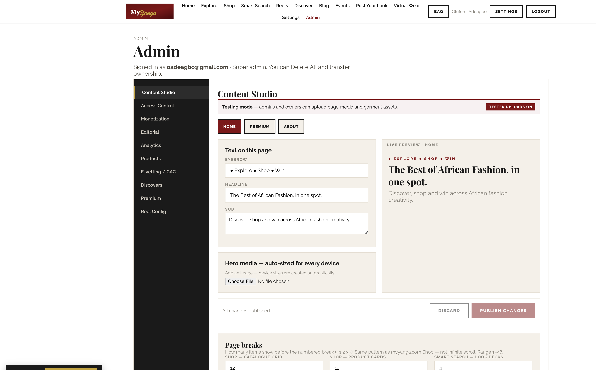
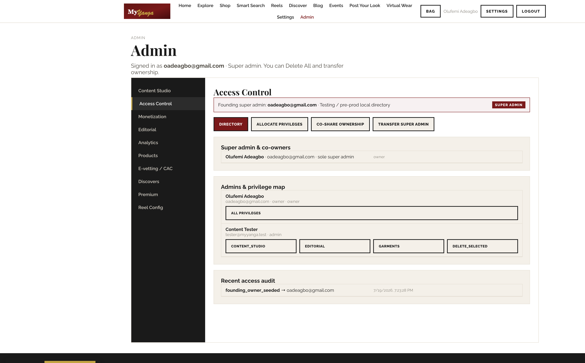
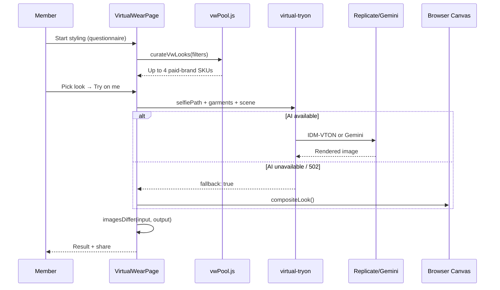
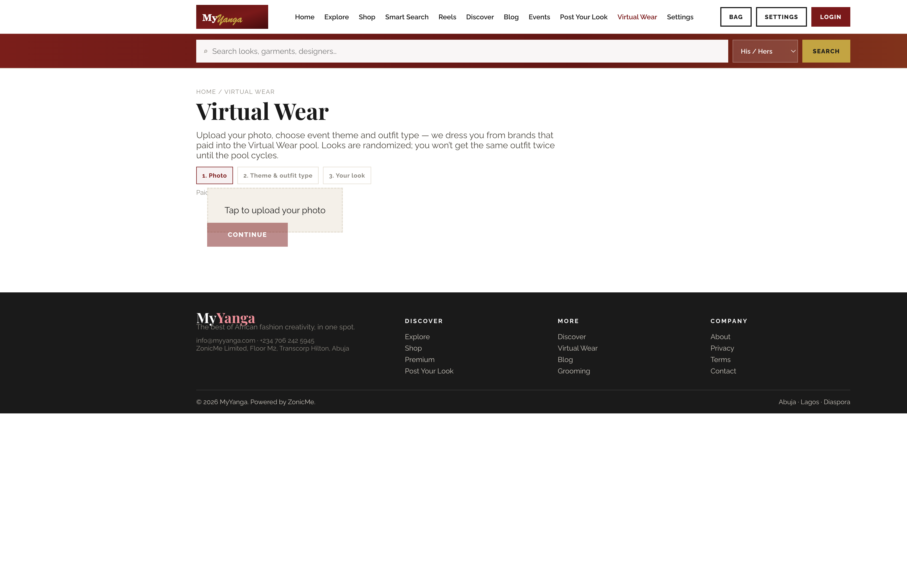
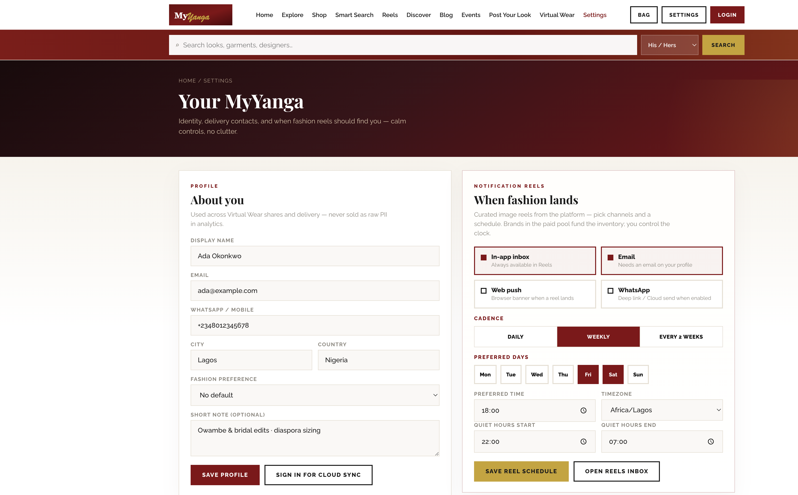

# MyYangaX

**MyYanga v5 with Lovable Virtual Wear UI**  
**Version:** 5.0.0 (MyYangaX staging handoff)  
**Document date:** 5 August 2026  
**Prepared for:** ZonicMe Limited — Abuja · Lagos · Diaspora  
**Confidential**

---

## Table of Contents

1. Application Overview & Features  
2. Capabilities by Persona  
3. Technical Architecture  
4. SWOT Analysis  
5. Market Analysis  
6. Digital Market Expansion  
7. Screenshots  
8. Installation & Deployment Brief  

---

## 1. Application Overview & Features

### What is MyYangaX?

**MyYangaX** is the branded staging handoff for **MyYanga v5** — a pre-production African fashion and lifestyle platform that connects fashion lovers, African creatives/brands, and the platform operator (ZonicMe). The August 2026 release integrates the **Lovable Virtual Wear UI**: a questionnaire-driven styling flow that curates up to four looks from a **paid brand pool**, then renders photorealistic or canvas try-on results.

> Discover African creatives. Engage with their work. Patronize them directly. See yourself in their fashion before you buy — and let fashion reels find you on *your* schedule.

### Core pillars

| Pillar | Description |
|--------|-------------|
| **Virtual Wear** | Lovable-style stage machine: landing → questionnaire → loading → results grid → try-on. Paid brands only (`is_promoted`). Client-side `curateVwLooks()` — no separate curation edge. |
| **Smart Search** | Multi-parameter AI discovery: His/Hers, country, event, style, colour, piece, price band — every filter narrows together. |
| **Reels** | Member-controlled fashion reel delivery: in-app inbox, email, web push, WhatsApp — cadence and quiet hours in Settings. |
| **Discover & Shop** | Promoted brand pool with equal WhatsApp / Instagram / Virtual Wear / Shop actions. E-vetted brands unlock gateway-split checkout. |
| **Editorial & Blog** | Carousel programming + acquisition blog funnel with guest comments. |
| **Admin & Governance** | Full operator console: content, monetization, e-vetting (CAC), analytics, insights, reel config, access control. |

### MyYangaX branding differentiators

- **Lovable questionnaire flow** — selfie moderation, gender, event, vibes, budget, age group, modesty slider; profile pre-fill from member settings.
- **Paying brand pool** — only brands with `creator_promotion` / `is_promoted` rotate into Virtual Wear and Discover; fair no-repeat until pool cycles.
- **Try-on pipeline** — Replicate IDM-VTON → Gemini image edit → on-device canvas fallback; `imagesDiffer()` guard; `garmentArt` SVG when DB rows lack images.
- **Trust platform** — MyYanga is not merchant of record; Flutterwave/Paystack gateway split settles funds to designers.

### Feature gates (monetization)

| Gate | Feature |
|------|---------|
| `virtual_wear` | Virtual try-on |
| `smart_search` | Smart Search AI |
| `pyl_entry` | Post Your Look competition entry |
| `premium` | Premium membership |
| `events` | Event access |
| `creator_promotion` | Paid placement in Discover + VW pool |
| `retail_checkout` | Marketplace bag (gateway split — not an entitlement gate) |

Payment provider cascade: **Flutterwave → Paystack → Stripe**.

---

## 2. Capabilities by Persona

### 2.1 Users & Reviewers

**Authentication (priority order)**

| Method | Implementation |
|--------|----------------|
| **Google OAuth** | Primary CTA; founding email `oadeagbo@gmail.com` auto-claims super admin |
| **WhatsApp OTP** | Secondary; Meta Cloud API via `auth-whatsapp` edge (no BSP) |
| **Email magic link / password** | Tertiary path via Supabase Auth |

**Member features**

| Area | Capabilities |
|------|--------------|
| **Virtual Wear** | Lovable landing → questionnaire → up to 4 curated looks → Try on me → share/download look |
| **Smart Search** | Filter garments and assembled look decks by gender, geography, occasion, style, colour, piece, price |
| **Reels** | In-app inbox; channel toggles; full schedule in Settings |
| **Settings** | Profile (name, email, phone, city, country, fashion preference, bio); reel cadence, days, timezone (Africa/Lagos default), quiet hours |
| **Discover** | Promoted brands; patronize via WhatsApp, Instagram, Virtual Wear, Shop |
| **Shop** | PDP, Bag, checkout for e-vetted brands only |
| **Blog** | Editorial acquisition funnel; share; guest comments |
| **Competitions** | Post Your Look; voting; shareable `/look/{code}` pages |


### 2.2 Brands (Creators)

Brands are onboarded through **Admin E-vetting / CAC** and monetize via **promotion seats** and optional **e-vetted retail**.

| Capability | Detail |
|------------|--------|
| **Promotion seat** | Pay `creator_promotion` → `is_promoted` → appears in Discover + Virtual Wear paid pool |
| **Garment catalog** | `main_outfit` and accessories with gender, event tags, style, price; matched by VW filters |
| **E-vetting (CAC)** | Admin verifies RC, director ID, TIN, contacts, scandal search → `is_e_vetted` unlocks Add to Bag + Flutterwave subaccount |
| **Brand placements** | Reel Config: brand ad slots per reel (max 0–15 slots) |
| **Patronage channels** | Equal-weight WhatsApp, Instagram, Virtual Wear, Shop on Discover cards |
| **Analytics (Insights)** | Brand-scoped insight packs: colours, VW renders, price bands, engagement; exportable via `orbit_brand_key` |
| **Settlement** | Gateway commission split at checkout — MyYanga never holds bag total |

**E-vetting workflow (Admin → E-vetting / CAC)**

1. Open CAC portal / search brand RC  
2. Snap listing into form (legal name, RC, address, director, TIN)  
3. Complete contacts, socials, adverse-media notes  
4. Upload director ID shot  
5. Tick CAC verified + scandals cleared  
6. Approve e-vet + unlock cart → sets `is_e_vetted` + `is_promoted`




### 2.3 Admin & Platform Operator

**Roles hierarchy**

| Role | Powers |
|------|--------|
| **Founding owner (super admin)** | `oadeagbo@gmail.com` — auto-claimed on Google sign-in; sole `delete_all`; transfer super admin |
| **Co-owners** | `platform_co_owners` table; super-admin-equivalent via `is_super_admin()` |
| **Delegated admins** | `admin_privileges` grants per-studio access |
| **Tester** | `tester@myyanga.test` / `Test2026!` for QA audits |

**Privilege catalog** (`PRIVILEGE_CATALOG`)

| Privilege | Studio |
|-----------|--------|
| `content_studio` | Page copy and media |
| `editorial` | Carousel programming |
| `monetization` | Feature prices and pay gates |
| `analytics` | Platform KPIs + fashion rollups |
| `catalog` | Products, brands, discovers |
| `brand_e_vetting` | CAC verify, promote, unlock cart |
| `garments` | Virtual Wear asset uploads |
| `reel_config` | Reel structure + brand placements |
| `events` | Event publishing |
| `users_roles` | Promote users to admin/brand |
| `access_control` | Directory view (mutations owner-gated) |
| `delete_selected` | Multi-select delete |
| `delete_all` | Owner-level wipe (dangerous) |

**Admin studios**

| Studio | Purpose |
|--------|---------|
| Content Studio | Page copy/media, garment uploads |
| Access Control | Directory, privileges, co-owners, transfer, audit log |
| Monetization | Per-feature free/paid + provider order |
| Editorial | Outfit/Bride/Groom/Couple of the Week, creative focus |
| Analytics / Insights | Site KPIs, fashion rollups, AI assistant, brand packs |
| Catalog | Products, discovers, premium rows |
| E-vetting / CAC | Brand verification and promotion |
| Reel Config | Reel structure, brand ad slots, delivery metering |

Security: rights mutations are **SECURITY DEFINER RPCs** with `access_audit_log` — UI is convenience, not the boundary. RLS on profiles prevents self-elevation.






---

## 3. Technical Architecture

### 3.1 Stack overview

```
┌─────────────────────────────────────────────────────────────────┐
│                     CLIENT (React 18 + Vite 5)                     │
│  myyanga-app.jsx · pages · PayGate · design system (maroon/gold) │
├─────────────────────────────────────────────────────────────────┤
│  virtualWear.js │ vwPool.js │ garmentArt.js │ smartSearch.js      │
│  analytics.js   │ dataBridge │ memberSettings │ reelEngine.js     │
└───────────────────────────┬─────────────────────────────────────┘
                            │ HTTPS + JWT
┌───────────────────────────▼─────────────────────────────────────┐
│                    SUPABASE DATA PLANE                           │
│  Postgres + RLS │ Auth │ Storage │ Edge Functions (Deno)         │
├─────────────────────────────────────────────────────────────────┤
│  virtual-tryon │ smart-search │ auth-whatsapp │ send-reel        │
│  payments      │ ai-chat      │                                   │
└───────────────────────────┬─────────────────────────────────────┘
                            │
        ┌───────────────────┼───────────────────┐
        ▼                   ▼                   ▼
   Replicate           Gemini 2.5          Flutterwave/
   IDM-VTON            Flash Image         Paystack/Stripe
```

### 3.2 Frontend architecture

| Module | Responsibility |
|--------|----------------|
| `src/myyanga-app.jsx` | Shell, routing (`view=` query + `/look/:code`), design tokens, admin tabs |
| `src/pages/VirtualWearPage.jsx` | Lovable stage machine UI |
| `src/lib/vwPool.js` | `curateVwLooks()`, budget/vibe/modesty filters, no-repeat store |
| `src/lib/virtualWear.js` | `aiTryOn()`, `compositeLook()`, `imagesDiffer()`, `renderLook()` |
| `src/lib/garmentArt.js` | `enrichGarmentImages()` — SVG overlays for imageless garments |
| `src/lib/selfieUpload.js` | `moderateSelfie()`, `prepareSelfieForTryOn()` |
| `src/lib/smartSearch.js` | Client orchestration → `smart-search` edge |
| `src/hooks.js` | `useAuth()` — Google / WhatsApp / email; founding owner claim |
| `src/lib/dataBridge.js` | Testing ⇄ Production mode switch |

### 3.3 Edge functions

| Function | Purpose | Auth |
|----------|---------|------|
| `virtual-tryon` | AI try-on cascade; `get_feature_gate(virtual_wear)` → 402 if unpaid | JWT required |
| `smart-search` | Multi-parameter garment matching with array overlaps | JWT required |
| `auth-whatsapp` | WhatsApp OTP request/verify via Meta Cloud API | Public (rate-limited) |
| `send-reel` | Reel delivery engine (inbox, email, push, WhatsApp queue) | Service/cron |
| `payments` | Flutterwave/Paystack/Stripe feature gates + retail split | JWT + webhooks |
| `ai-chat` | Stylist / insights assistant (Anthropic Claude) | JWT |

### 3.4 Virtual Wear pipeline



**Key guards**

- **PayGate** — client wrapper + server 402 on unpaid `virtual_wear`  
- **Paid pool only** — `creators.is_promoted` / `vw_pool_active`  
- **No-repeat** — `localStorage` worn-outfit set per device (cap 200 IDs)  
- **imagesDiffer** — rejects unchanged output (hostile audit hard rule)  
- **garmentArt** — runtime SVG when seed garments lack `image` URLs  

### 3.5 Database migrations (001–011)

| Migration | Scope |
|-----------|-------|
| `001_schema` | Core tables: profiles, creators, garments, settings |
| `002_owner_and_delete` | Owner role, delete RPCs |
| `003_seed` | Development seed data |
| `004_production_core` | Production-ready core |
| `005_monetization` | Feature gates, entitlements |
| `006_seed_production` | Production garment seed (imageless → garmentArt) |
| `007_access_control` | Co-owners, privileges, audit log, founding owner |
| `008_analytics_events` | Anonymized fashion analytics |
| `009_marketplace_commerce` | Bag, orders, Flutterwave subaccounts |
| `010_brand_e_vetting` | CAC dossier columns |
| `011_blog` | Blog posts, guest comments |

### 3.6 Hostile audit (3-tier quality gate)

| Tier | Scope | Verdict rule |
|------|-------|--------------|
| **Tier 1 — BUILD** | install, lint, build, verify:production, unit tests | Must pass |
| **Tier 2 — MOCK** | Dev server + Playwright/DOM: routes, VW canvas ≠ input, Smart Search filters, auth modal, admin | Must pass for SHIP |
| **Tier 3 — LIVE** | Real Supabase edges: 401 without auth, array filters, try-on honesty | PARTIAL if skipped |

```bash
npm run audit:hostile              # all tiers
npm run audit:hostile:mock-only    # tier 1 + 2 (38/38 PASS after Lovable integration)
npm run audit:hostile:live         # requires cloud creds
```

**Proven:** build, garment art, canvas compositing, route wiring, PayGate, pool exports.  
**Not proven:** 100+ concurrent AI try-ons, burst Replicate queue, p95 edge timeouts.

### 3.7 Testing vs Production

| | Testing (default) | Production |
|--|-------------------|------------|
| Data | Seeded mocks + localStorage | Supabase Postgres + RLS |
| Auth | Google/WhatsApp/email; founding = owner | DB roles; WhatsApp via edge |
| Virtual Wear | Canvas compositing | Gemini/Replicate + canvas fallback |
| Pay gates | All free | Live gates + payments |
| Analytics | Local device queue | `analytics_events` table |

---

## 4. SWOT Analysis

### Context: African fashion tech, Nigeria market

Nigeria is Africa's largest economy and a global hub for African fashion (Lagos Fashion Week, Nollywood styling, owambe culture). Smartphone penetration exceeds 45%; WhatsApp is the default commerce channel. Diaspora remittances and cultural pride drive demand for authentic African fashion abroad.

| | |
|---|---|
| **Strengths** | End-to-end v5 platform shipped; Lovable VW UI differentiated; paid pool fairness model; WhatsApp-native auth; trust-platform checkout (no MoR); hostile audit 80/80 SHIP; multi-parameter Smart Search; member-controlled reels |
| **Weaknesses** | AI try-on latency (15–90s); no job queue for burst traffic; seeded garment art placeholders; blog CMS thin vs editorial studio; webhook signature depth; enterprise scale unproven |
| **Opportunities** | Nigeria → Ghana/Kenya/SA expansion; UK/US/Canada diaspora; influencer commerce; newspaper/media embed (AdSpotX-style partner network for fashion editorials); telco data bundles; wedding/owambe seasonality |
| **Threats** | Instagram/WhatsApp informal commerce inertia; global fast-fashion apps; FX volatility affecting AI API costs; Replicate/Gemini rate limits; regulatory shifts on CAC/KYC; competitor virtual try-on from global players |

---

## 5. Market Analysis

### 5.1 Digital fashion & virtual try-on in Africa

| Trend | Africa-specific angle |
|-------|----------------------|
| **Virtual try-on global CAGR ~25%** | Diaspora sizing friction + trust deficit in DM commerce make "see yourself" especially valuable for Ankara, Agbada, Aso-Oke |
| **Influencer commerce** | Nollywood, Instagram stylists, owambe culture — reels on member schedule reduce fatigue vs spam |
| **Creative economy policy** | Nigeria Creative Industry Financing Initiative, AfCFTA — platforms that verify brands (CAC) align with policy |
| **Mobile money / gateways** | Flutterwave/Paystack dominance — gateway split model fits local payment rails |

### 5.2 Addressable segments

1. **B2C fashion lovers** — Nigeria (primary), Ghana, Kenya, South Africa + UK/US/Canada diaspora  
2. **B2B creatives/brands** — Designers, fabric makers, photographers, MUA seeking discovery + direct patronage  
3. **B2B2C partners** — Media houses, event sponsors, retailers embedding MyYanga discovery (AdSpotX analogue: partner embed without building fashion tech)

### 5.3 Competitive positioning

| Alternative | MyYangaX gap closed |
|-------------|---------------------|
| Instagram / WhatsApp DMs | E-vetting, VW pool fairness, member reel clock |
| Global marketplaces | African creative curation; diaspora sizing narrative |
| Pure social fashion apps | Monetization for brands; CAC trust layer |
| Traditional e-commerce | Trust platform — funds settle to designers at gateway |

---

## 6. Digital Market Expansion

### 6.1 Geographic growth scenarios

| Phase | Markets | Focus |
|-------|---------|-------|
| **Year 1** | Nigeria (Lagos, Abuja, PH) | Paid VW pool brands, owambe/wedding season, WhatsApp reels |
| **Year 2** | West Africa (Ghana, Senegal, Côte d'Ivoire) | Local designer onboarding, Accra timezone defaults |
| **Year 3** | Pan-Africa + diaspora (UK, US, Canada) | Multi-currency checkout, diaspora sizing content, partner media embeds |

### 6.2 Revenue streams

| Stream | Year 1 target | Year 2 target | Year 3 target |
|--------|---------------|---------------|---------------|
| Brand promotion seats (`creator_promotion`) | 50 brands × ₦150k/yr | 200 brands | 500 brands |
| Virtual Wear pay gate (`virtual_wear`) | 5k paid try-ons/mo | 25k/mo | 100k/mo |
| Smart Search (`smart_search`) | Freemium → 2k subs | 10k subs | 40k subs |
| Retail commission (gateway split) | 2% on ₦50M GMV | ₦300M GMV | ₦1B GMV |
| Insights / Orbit brand packs | Pilot 10 brands | 50 brands | 200 brands |
| Reel brand placements | 20 slots/mo | 100 slots/mo | 400 slots/mo |

### 6.3 Partner expansion (AdSpotX model analogue)

| Partner type | Integration | Revenue share |
|--------------|-------------|---------------|
| **Newspapers / media** | Embed "Try on MyYanga" widget in fashion editorials | CPM + promotion seat referral |
| **Retailers / malls** | In-store QR → VW for stocked designers | Commission on attributed sales |
| **Event sponsors** | LFW, owambe planners — gated event tickets + VW booths | Event gate + brand packages |
| **Telcos** | Zero-rated app access or bundle with data plans | Subsidy + promoted brand inventory |

### 6.4 Three-year expansion roadmap

| Quarter | Milestone | KPI |
|---------|-----------|-----|
| **Q3 2026** | MyYangaX staging → production Amplify deploy | Hostile audit Tier 3 PASS |
| **Q4 2026** | 25 paid promotion brands; LFW partnership pilot | 10k MAU |
| **Q1 2027** | Ghana designer onboarding; reel WhatsApp Cloud live | 50k MAU |
| **Q2 2027** | Job queue for AI try-on; rate limiting | p95 try-on < 45s |
| **Q3 2027** | Media partner embed (1 newspaper group) | 100k MAU |
| **Q4 2027** | Diaspora campaign (UK/Nigeria corridor) | ₦500M annualized GMV |
| **2028** | Kenya + SA launch; Orbit insights monetization | 500k MAU |
| **2029** | Pan-African paid pool; 3 media partners | ₦2B GMV; profitable unit economics |

---

## 7. Screenshots

### Virtual Wear — Lovable UI




### Discovery & engagement




---

## 8. Installation & Deployment Brief

*Source: `docs/AWS_RESTAGE.md`*

### Prerequisites

- Node.js 20+ (tested on 24.x)  
- AWS Amplify (or S3 + CloudFront) for static hosting  
- Supabase cloud project **or** local Supabase Tester for QA  

### Quick start

```bash
cd ~/Downloads/myyanga-v5   # or unpack MyYangaX.zip
npm install
npm run build
```

### Environment variables

| Secret | Where |
|--------|-------|
| `VITE_SUPABASE_URL` | Supabase → Settings → API |
| `VITE_SUPABASE_ANON_KEY` | Supabase → Settings → API |
| `PUBLIC_APP_URL` | Amplify domain (e.g. `https://app.myyanga.com`) |
| `SUPABASE_SERVICE_ROLE_KEY` | Server/edge only — never in client bundle |

**Edge function secrets:** `REPLICATE_API_TOKEN`, `GOOGLE_API_KEY`, `WHATSAPP_CLOUD_TOKEN`, `WHATSAPP_PHONE_NUMBER_ID`, payment keys per `docs/AWS_SECRETS_RUNBOOK.md`.

### Local QA without cloud Supabase

```bash
npm run supabase-tester:start    # :54322
npm run dev:tester               # Vite + .env.supabase-tester
USE_SUPABASE_TESTER=1 npm run audit:hostile
```

### Deploy pipeline

```bash
supabase link --project-ref YOUR_REF
npm run sb:deploy                # all edge functions
supabase db push                 # migrations 001–011
npm run build                    # dist/
# Amplify: build command npm run build, output dist/, SPA fallback /* → /index.html
```

### Post-deploy smoke

```bash
LIVE_SITE_URL=https://your-amplify-url.amplifyapp.com \
VITE_SUPABASE_URL=... \
VITE_SUPABASE_ANON_KEY=... \
npm run audit:hostile:live
```

### Hosting options

| Platform | Role |
|----------|------|
| **AWS Amplify** | Primary static SPA host; env vars at build time |
| **Railway** | Alternative Node/static host; same `dist/` artifact |
| **Supabase** | Auth, Postgres, Storage, Edge Functions data plane |

### Rollback

- **Amplify:** redeploy previous build from console  
- **Supabase:** restore DB snapshot or point env to previous project  
- **Edge functions:** `supabase functions deploy <name>` from CLI history  

### Tester accounts

| Email | Password | Role |
|-------|----------|------|
| `tester@myyanga.test` | `Test2026!` | Admin (tester) |
| `oadeagbo@gmail.com` | (Google OAuth) | Founding owner |

### Generate this PDF

```bash
npm run docs:myangax
# Output: docs/MyYangaX.pdf and ~/Downloads/MyYangaX.pdf
```

---

*Prepared for ZonicMe Limited — MyYangaX complete platform overview. Confidential.*
